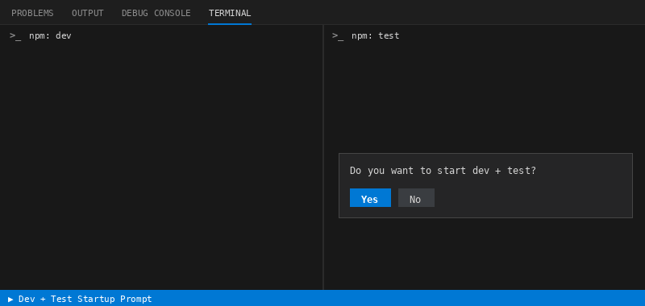

# Dev + Test Startup Prompt

**Open a project. Hit "Yes". Your dev server and your tests are already running.**

No more typing `npm run dev` in one terminal and `npm run test` in another, every single time.

## How it works

1. **Open a folder** whose `package.json` has both a `dev` and a `test` script.
2. **Click Yes** on the prompt.
3. **Done.** Both tasks start in parallel, side by side in the terminal panel.

Click Yes once and it remembers. Next time you open the project, everything just starts. No prompt.

## Zero setup

The first time it runs, the extension adds three tasks to your `.vscode/tasks.json`, only the ones you don't already have:

| Task | What it does |
| --- | --- |
| `npm: dev` | Runs `npm run dev` in the background |
| `npm: test` | Runs `npm run test` in its own panel |
| `dev + test` | Starts both in parallel |

Your existing tasks and comments are left untouched. If `package.json` has no `dev` or no `test` script, the extension does nothing at all.

## Commands

Open the Command Palette (`Ctrl+Shift+P` / `Cmd+Shift+P`) and run **Start Dev + Test** to launch it any time.

## Settings

| Setting | Default | Description |
| --- | --- | --- |
| `devTestStartup.autostart` | `false` | Start automatically on open, with no prompt. Set to `true` when you click Yes. |
| `devTestStartup.taskName` | `dev + test` | The task to run. Point it at any task in your workspace. |
| `devTestStartup.prompt` | `Do you want to start dev + test?` | The text of the prompt. |

**Want the prompt back?** Set `devTestStartup.autostart` to `false` (or delete it) in your workspace settings.

## Requirements

- A workspace with a `package.json` that defines `dev` and `test` scripts
- npm available in your terminal

---

Enjoy the quiet. 🚀
